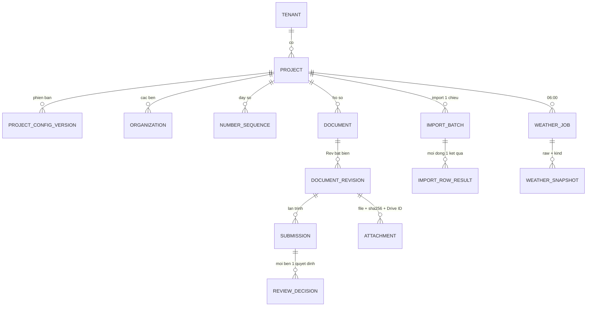

# G2 — Kiến trúc và các ADR (V3)
Các ADR này thay thế ADR-001…006 trong `G2_ADR.md` ở những điểm mâu thuẫn. Những điểm khác giữ nguyên.

## ADR-001 — Hướng chuyển đổi: (B) lai, chuyển dần theo từng module
- **Quyết định:**
  - Register Google Sheets vẫn là nơi các bên (TBCONS / TVGS / CĐT) nhập liệu.
  - Apps Script S1 (đọc, QC, nhắc hạn, thời tiết) chạy ngay trên Register.
  - Backend C# ASP.NET Core .NET 10 + PostgreSQL được dựng song song. Từng module lần lượt chuyển nguồn chính sang PG.
- **Lý do:** chỉ thị yêu cầu không rewrite. Các bên đã quen nhập Sheets. R1 (cấp số) và R5 (đồng bộ) chỉ giải được khi có DB.
- **Hệ quả:** có thời gian chạy hai hệ. ADR-002 đặt kỷ luật để không có hai nơi cùng được ghi.

## ADR-002 — Nguồn dữ liệu chính theo giai đoạn (không đồng bộ hai chiều)
| Giai đoạn | Nguồn chính | Chiều đồng bộ | Ghi chú |
|---|---|---|---|
| Hiện tại (S1) | Register Sheets | Sheets → TQN_DATA (projection, chỉ đọc) | Đang có |
| G4 | Register Sheets | Sheets → PG qua `import_batch` (xem trước, rồi áp dụng) | PG mới là bản đối chiếu |
| G5, module **cấp số** | **PG** | PG → Sheets (ghi mã đã cấp vào cột mã) | Từ lúc này không gõ tay mã mới |
| G5, module **duyệt** | **PG** (`review_decision`) | PG → Sheets (cột kết quả là projection) | Cột kết quả trên Sheets bị khóa vùng |
| G8, thời tiết | **PG** | PG → tab Theo dõi thời tiết | Tắt trigger Apps Script sau khi Engine chạy ổn 7 ngày |

**Quy tắc:** ở mỗi thời điểm, mỗi trường dữ liệu chỉ có một nơi được ghi. Sửa tay trên projection thì lần đồng bộ sau phát hiện và báo CONFLICT, không ghi đè im lặng.

## ADR-003 — Định danh, Revision, cấp số
- Các bảng `document`, `document_revision`, `submission` và `review_decision` để riêng, không gộp.
- `document_revision` và `audit_event` có trigger chặn UPDATE/DELETE.
- `raw_document_number` giữ nguyên số hiệu đã phát hành.
- `rev_label` theo profile: Rev00/01 cho hồ sơ, A/B/C cho bản vẽ.
- Cấp số bằng `next_number(project, type, scope)`, là một câu `UPDATE … RETURNING` trong transaction.
- **Bằng chứng:** `db/schema_v0.sql`, test T02–T06, T10 PASS (`evidence/v3/G2_db_test_log.txt`).

## ADR-004 — Đa dự án, đa đơn vị
- Mọi bảng nghiệp vụ có `tenant_id` + `project_id`.
- Có khóa ngoại kép `(tenant_id, project_id)` để không gắn được hồ sơ sang dự án của tenant khác (test T09).
- API luôn lọc theo membership. RLS PostgreSQL là lớp bảo vệ thứ hai.
- Thêm dự án bằng `project_config_version` (Project Wizard), không sửa code.
- Profile `COASTAL_2026_V1` là dữ liệu cấu hình, không phải code.

## ADR-005 — Xác thực và phân quyền
- Đăng nhập bằng Google OIDC, vì các bên đã dùng tài khoản Google để vào Register.
- Phân quyền RBAC theo membership dự án:

| Vai trò | Quyền |
|---|---|
| Quản trị dự án (anh Nho) | Toàn quyền cấu hình, duyệt import, chạy backfill thời tiết |
| Nhà thầu (TBCONS) | Tạo hồ sơ, xin cấp số, tải file, trình |
| TVGS / CĐT / TVTK | Xem hồ sơ trình cho mình, ghi `review_decision` của tổ chức mình |
| Chỉ xem | Dashboard, báo cáo |

- Trên Register Sheets, khóa vùng theo bên nhập. Việc này nằm ở S2, cần anh duyệt OAuth.

## ADR-006 — Web UI
- **Chọn:** Blazor Web App (.NET 10), dùng chung C# với backend, có 2 theme sáng/tối và responsive.
- **Không chọn React:** thêm một stack và một bộ build. Chưa có framework UI cũ nào cần giữ.
- **Thanh bên Apps Script** vẫn giữ cho người làm trong Sheet.

## ADR-007 — Hosting và lịch chạy (chờ anh chọn, mặc định a)
| Phương án | Ưu | Nhược |
|---|---|---|
| **(a) Google Cloud Run + Cloud SQL PostgreSQL + Cloud Scheduler** | Cùng hệ sinh thái Google với Register/Drive. Scheduler hỗ trợ cron theo múi giờ. Chạy khi máy anh tắt | Có phí hằng tháng. Cần tài khoản thanh toán |
| (b) VPS (Ubuntu + Docker + PostgreSQL) | Phí cố định, toàn quyền | Tự lo backup, bảo mật, cập nhật |
| (c) Máy anh | Miễn phí | **Loại**: máy tắt thì không chạy 06:00 |

SLA đề xuất: bắt đầu trong vòng 5 phút sau 06:00 ở điều kiện cloud bình thường. Không cam kết đúng tuyệt đối 06:00.

## ADR-008 — Tích hợp Google, Excel, render
- **Google Drive/Sheets:**
  - dùng service account, chỉ có quyền trên thư mục dự án (không cấp quyền toàn Drive);
  - retry/backoff khi gặp 429/503;
  - lưu Drive file ID và SHA256 vào `attachment` / `report_artifact`.
- **Excel:** VBA v1 in phiếu giữ nguyên. Adapter `TQN_ExcelClient` gọi API ở G7. Không chứa secret trong .xlsm.
- **Render PNG/PDF:**
  - một HTML/CSS template và một view model, render bằng headless Chromium (Playwright) trong sandbox, chỉ nạp template nội bộ;
  - đã có Chromium và Playwright trong máy làm việc để làm POC.

## ADR-009 — TQN Weather Engine (theo yêu cầu bổ sung 11:10)
- **`IWeatherProvider`** gồm các hàm `GetCurrentAsync`, `GetHourlyAsync(today + tomorrow)` và `GetDailyAsync`. Kết quả trả về `WeatherBundle` đã chuẩn hóa (°C, mm, %, km/h, mã hiện tượng nội bộ) kèm provider, model, `issued_at`, `kind = FORECAST`.
- **Các provider:**
  - `OpenMeteoProvider`: chọn chính, khi đã có gói thương mại hoặc anh xác nhận mục đích phi thương mại;
  - `GoogleWeatherProvider`: tùy chọn;
  - `FallbackProvider`: provider thứ hai cấu hình theo dự án.
- **Kiểm Google Weather API cho Việt Nam:**
  - Google công bố API hỗ trợ mọi quốc gia trừ Nhật, Hàn và vùng bị cấm, ở khu vực có dân cư, và bắt buộc có tài khoản thanh toán;
  - khi hiển thị phải ghi "Source: Includes weather data from Google";
  - việc lưu trữ nội dung bị giới hạn theo điều khoản dịch vụ;
  - ⇒ **chưa chọn Google làm nguồn chính.** Trước hết cần gọi thử bằng API key thật tại tọa độ công trường (BLOCKED, cần key), và xin ý kiến pháp lý về việc lưu PNG/PDF có số liệu Google lâu dài trên Drive.
- **Phân biệt ba loại dữ liệu:** `FORECAST` (API), `OBSERVATION` (trạm/thiết bị đo, nếu có), `SITE_NOTE` (cán bộ công trường ghi và ký xác nhận). Ba loại này nằm ở ba bảng/cột khác nhau và hiển thị khác màu.
- **Lịch:**
  - `0 6 * * *`, múi giờ `Asia/Ho_Chi_Minh`;
  - `weather_job` ghi `scheduled_for` và `started_at`/`finished_at` thực tế;
  - khóa `(project_id, local_date, job_type, slot)` (test T07).
- **Chặn phát hành trống hoặc trùng:**
  - thiếu GPS xác nhận thì không bật được (test T08);
  - thiếu giờ 06–23 hoặc thiếu trường bắt buộc thì job PARTIAL và **không render**;
  - cùng slot chỉ có một báo cáo logic; render lại thì tăng phiên bản.
- **Cấm:** không chụp màn hình, không scrape ứng dụng Google/Samsung Weather.

## ERD (rút gọn)


## Luồng dữ liệu
```
Các bên nhập ─► Register Google Sheets ─(Apps Script S1: đọc, QC, nhắc)─► tab TQN_* (projection)
                         │
                         └─(G4 import 1 chiều, preview → duyệt → apply)─► PostgreSQL ◄─ Web/API C#
PostgreSQL ─(G5: mã đã cấp, kết quả duyệt)─► ghi về cột tương ứng của Register (vùng bị khóa)
Cloud Scheduler 06:00 ─► Weather Engine ─► PG (job, snapshot) ─► render PNG/PDF ─► Drive ─► link về Register
```

## Migration và rollback
1. Import luôn chạy **PREVIEW** trước. Áp dụng cần người có quyền duyệt. `source_sha256` của file nguồn được ghi lại và kiểm bất biến trước và sau.
2. Mỗi lần APPLY gắn với một `batch_id`. Rollback = xóa các bản ghi do batch đó tạo (chỉ những bản ghi chưa có revision hoặc quyết định mới phát sinh sau), đánh trạng thái ROLLED_BACK. Trước APPLY luôn `pg_dump`.
3. Không ghi vào Register thật cho đến khi UAT trên **bản sao** đạt.
4. Cutover từng module có checklist và anh ký.

## Sprint 1 (vertical slice đầu tiên, ít rủi ro)
- **Phạm vi:** `Project (2 dự án) → cấp số → tạo Document + Rev00 → Audit → API đọc danh sách → xuất CSV`.
- Không đụng Register thật. Dữ liệu: fixture DEMO_A/DEMO_B.
- **Lệnh build:** `dotnet build && dotnet test` (cần .NET 10, hiện BLOCKED ở máy làm việc).
- **Tiêu chí PASS:**
  - 100 yêu cầu cấp số song song không trùng;
  - dự án A không đọc được hồ sơ của B qua API;
  - mỗi lần ghi có audit;
  - CSV mở bằng Excel đúng tiếng Việt.
- **Rollback:** xóa schema thử. Nhánh `v3/slice1`, không merge khi chưa có log PASS.
- **Song song**, vì không cần .NET: POC Weather report HTML → PNG/PDF cho 2 dự án bằng dữ liệu Open-Meteo thật (gọi qua trình duyệt trên máy anh) và Chromium trong máy làm việc.
